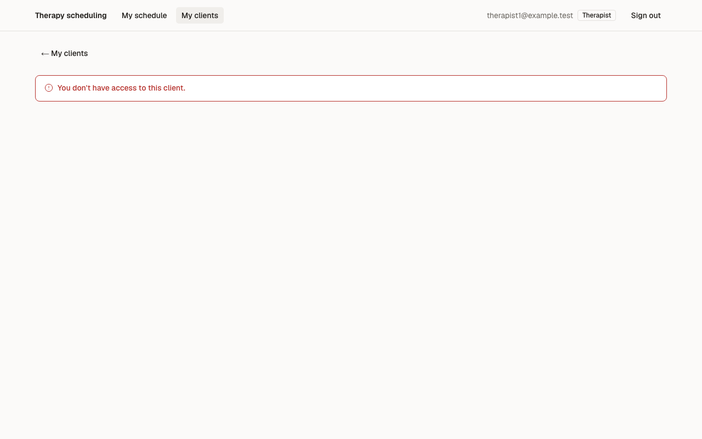
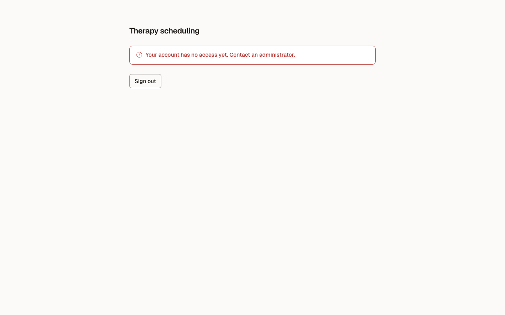
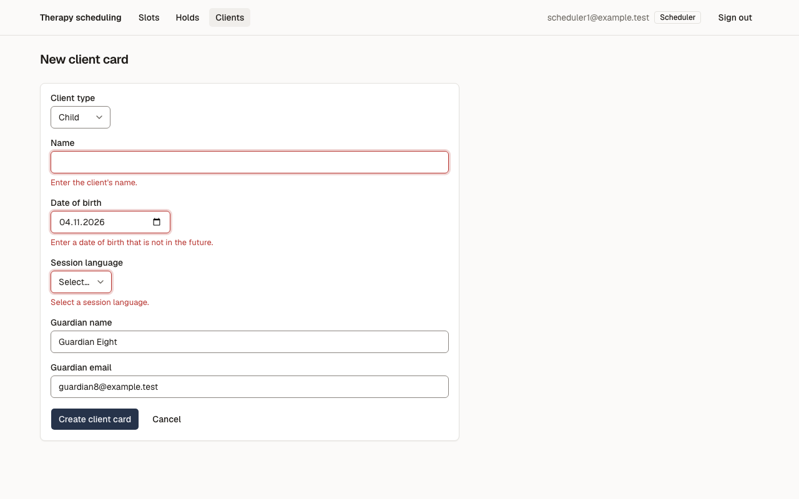

# Звіт UAT — 03.11.2026

- **Застосунок:** https://therapy-scheduling-sigma.vercel.app (/api/health: коміт `07b01cf`)
- **Код тестів:** `task/uat` @ `fc5f9e0`
- **Прогін:** 03.11.2026, 13:08 (Київ), Playwright 23.4 с; AC: 3 — PASS 3, FAIL 0, NEEDS-HUMAN 0
- **Рецензент:** `claude-haiku-5-5`; суперечки → `claude-sonnet-5-5`. Разом за розбір: $0.0066 (ціни API; за підпискою — у межах ліміту плану)
- **Прибирання:** не запускалось (прогін без SUPABASE_SECRET_KEY — лише AC, що нічого не пишуть)
- **Відео й траси:** не в git — `test-results/` локально або артефакт CI; трасу відкриває `npx playwright show-trace <trace.zip>`

| AC | Перевірки | Агент | Підсумок | Чому | Playwright | Розбір |
|---|---|---|---|---|---|---|
| AC-CARD-05 | пройшли | Haiku: PASS | **PASS** | R6: перевірки, агент і цитати збігаються | 3.9 с | $0.0020, 8.8 с |
| AC-CARD-11 | пройшли | Haiku: PASS | **PASS** | R6: перевірки, агент і цитати збігаються | 3.7 с | $0.0026, 9.3 с |
| AC-CARD-12 | пройшли | Haiku: PASS | **PASS** | R6: перевірки, агент і цитати збігаються | 7.9 с | $0.0021, 8.3 с |

## AC-CARD-05 — PASS

**Тест:** AC-CARD-05: therapist1 відкриває картку client9 за прямим посиланням — «You don't have access to this client.», даних client9 немає

**Критерій** (requirements/19-planuvalnyk-zapovniuie-kartku-klienta.md):

> AC-CARD-05: Дано client9 — свій клієнт лише для therapist2. Коли therapist1 відкриває картку client9 за прямим посиланням. Тоді therapist1 бачить повідомлення «You don't have access to this client.», жодних даних client9 не показано, і картка client9 не змінилася.

**Кроки:** ✔ Дано: client9 — свій клієнт лише для therapist2 → ✔ Коли: therapist1 відкриває картку client9 за прямим посиланням → ✔ Тоді: therapist1 бачить повідомлення «You don't have access to this client.», жодних даних client9 не показано, і картка client9 не змінилася.

**Агент (claude-haiku-5-5, PASS):** На кадрі frame-then-1.png у червоному блоці помилки видно текст «You don't have access to this client.», він читається чітко і збігається з критерієм за словами та крапкою в кінці. Сторінка показує лише цю помилку та навігацію therapist1 (My clients), без даних client9. Частини про відсутність даних і незмінність картки не з кадрів, тому я їх не оцінював.

**Цитати агента, звірені зі сторінкою (aria):**
- «You don't have access to this client.» — є на сторінці

**Правило:** R6: перевірки, агент і цитати збігаються

**Відео:** `test-results/artifacts/client-cards-терапевт-AC-C-6f835-lient-»-даних-client9-немає-chromium/video.webm` · **траса:** `test-results/artifacts/client-cards-терапевт-AC-C-6f835-lient-»-даних-client9-немає-chromium/trace.zip` (не в git)

**Рішення PM:** ☐ приймаю · ☐ відхилення від вимог (issue «Відхилення від вимог: AC-CARD-05 — …») · @login: ____

## AC-CARD-11 — PASS

**Тест:** AC-CARD-11: newuser1 без ролі відкриває застосунок і картку client6 за посиланням — лише «Your account has no access yet. Contact an administrator.» і «Sign out»

**Критерій** (requirements/19-planuvalnyk-zapovniuie-kartku-klienta.md):

> AC-CARD-11: Дано користувач newuser1@example.test увійшов, але не має ролі. Коли він відкриває застосунок або картку client6 за прямим посиланням. Тоді він бачить лише повідомлення «Your account has no access yet. Contact an administrator.» і дію «Sign out», жодних даних клієнтів не показано, і жодна картка не змінилася.

**Кроки:** ✔ Дано: користувач newuser1@example.test увійшов, але не має ролі → ✔ Коли: він відкриває застосунок → ✔ Тоді: він бачить лише повідомлення «Your account has no access yet. Contact an administrator.» і дію «Sign out», жодних даних клієнтів не показано, і жодна картка не змінилася. → ✔ Коли: він відкриває картку client6 за прямим посиланням → ✔ Тоді: він бачить лише повідомлення «Your account has no access yet. Contact an administrator.» і дію «Sign out», жодних даних клієнтів не показано, і жодна картка не змінилася.

**Агент (claude-haiku-5-5, PASS):** На обох кадрах (frame-then-1.png, frame-then-2.png) сторінка «/» показує заголовок «Therapy scheduling», червоний блок із текстом «Your account has no access yet. Contact an administrator.» і одну кнопку «Sign out». Обидві видимі частини «Тоді» збігаються з критерієм посимвольно. Частини про відсутність даних клієнтів і незмінність карток не з кадрів, тож їх не оцінював.

**Цитати агента, звірені зі сторінкою (aria):**
- «Your account has no access yet. Contact an administrator.» — є на сторінці
- «Sign out» — є на сторінці
- «Your account has no access yet. Contact an administrator.» — є на сторінці
- «Sign out» — є на сторінці

**Правило:** R6: перевірки, агент і цитати збігаються

**Відео:** `test-results/artifacts/client-cards-користувач-бе-8ab7b-dministrator-»-і-«Sign-out»-chromium/video.webm` · **траса:** `test-results/artifacts/client-cards-користувач-бе-8ab7b-dministrator-»-і-«Sign-out»-chromium/trace.zip` (не в git)

**Рішення PM:** ☐ приймаю · ☐ відхилення від вимог (issue «Відхилення від вимог: AC-CARD-11 — …») · @login: ____

## AC-CARD-12 — PASS

**Тест:** AC-CARD-12: scheduler1 створює картку «Child» без імені, з датою завтра й без мови — три повідомлення біля полів, картку не створено

**Критерій** (requirements/19-planuvalnyk-zapovniuie-kartku-klienta.md):

> AC-CARD-12: Дано сьогодні 2026-11-03. Коли scheduler1 створює картку з типом «Child», порожнім ім'ям, датою народження 2026-11-04, без мови сеансів, з ім'ям опікуна «Guardian Eight» і email опікуна guardian8@example.test. Тоді картку не створено, scheduler1 одразу бачить три повідомлення біля відповідних полів — «Enter the client's name.», «Enter a date of birth that is not in the future.» і «Select a session language.», а всі введені дані лишаються у формі.

**Кроки:** ✔ Дано: сьогодні 2026-11-03 → ✔ Коли: scheduler1 створює картку з типом «Child», порожнім ім'ям, датою народження 2026-11-04, без мови сеансів, з ім'ям опікуна «Guardian Eight» і email опікуна guardian8@example.test → ✔ Тоді: картку не створено, scheduler1 одразу бачить три повідомлення біля відповідних полів — «Enter the client's name.», «Enter a date of birth that is not in the future.» і «Select a session language.», а всі введені дані лишаються у формі.

**Агент (claude-haiku-5-5, PASS):** На кадрі /clients/new (форма «New client card») видно три червоні повідомлення під відповідними полями з точним текстом із критерію, а поля з помилкою підсвічені червоною рамкою. Тип «Child», ім'я опікуна «Guardian Eight» і email guardian8@example.test лишилися у формі. Поле дати показує 04.11.2026 — це локальний формат браузера для 2026-11-04, і за правилами це не оцінюється з кадру.

**Цитати агента, звірені зі сторінкою (aria):**
- «Enter the client's name.» — є на сторінці
- «Enter a date of birth that is not in the future.» — є на сторінці
- «Select a session language.» — є на сторінці
- «Child» — є на сторінці
- «Guardian Eight» — є на сторінці
- «guardian8@example.test» — є на сторінці

**Правило:** R6: перевірки, агент і цитати збігаються

**Відео:** `test-results/artifacts/client-cards-планувальник--4f8da-ля-полів-картку-не-створено-chromium/video.webm` · **траса:** `test-results/artifacts/client-cards-планувальник--4f8da-ля-полів-картку-не-створено-chromium/trace.zip` (не в git)

**Рішення PM:** ☐ приймаю · ☐ відхилення від вимог (issue «Відхилення від вимог: AC-CARD-12 — …») · @login: ____

## Як читати підсумок

- **PASS** — автоматичні перевірки пройшли, агент-рецензент погодився з кадром, а кожну його цитату знайдено на сторінці.
- **FAIL** — впала автоматична перевірка. Агент цього не перекриває: невидимі вади (буфер обміну, база) він на кадрі не побачить.
- **NEEDS-HUMAN** — перевірки зелені, але агент не погодився або його цитати немає на сторінці. Часто це слабкий тест або розбіжність між текстом AC і тестом — питання до PM, а не обов'язково вада продукту.

Правила: R1: перевірка впала — FAIL завжди, агент не перекриває; R2: немає вердикту агента або кадру; R3: перевірки пройшли, агент не погоджується — вирішує людина; R4: цитати агента немає на сторінці (aria) — не підтверджено; R5: помилка сторінки або 5xx під час сценарію; R6: перевірки, агент і цитати збігаються.
