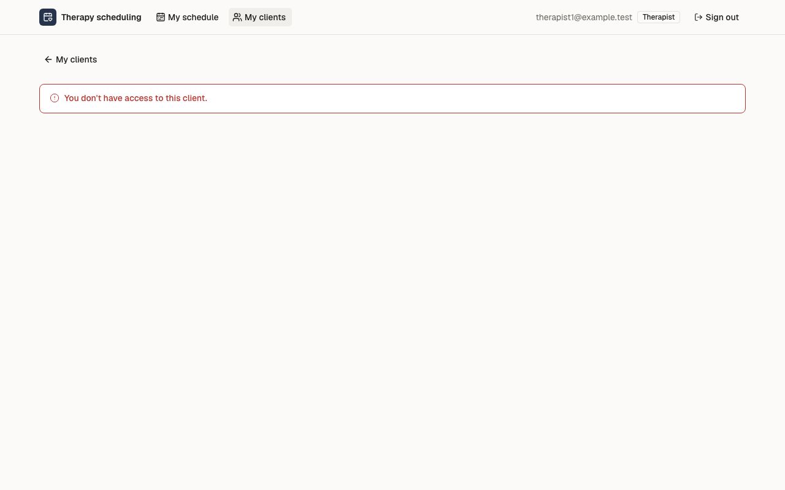
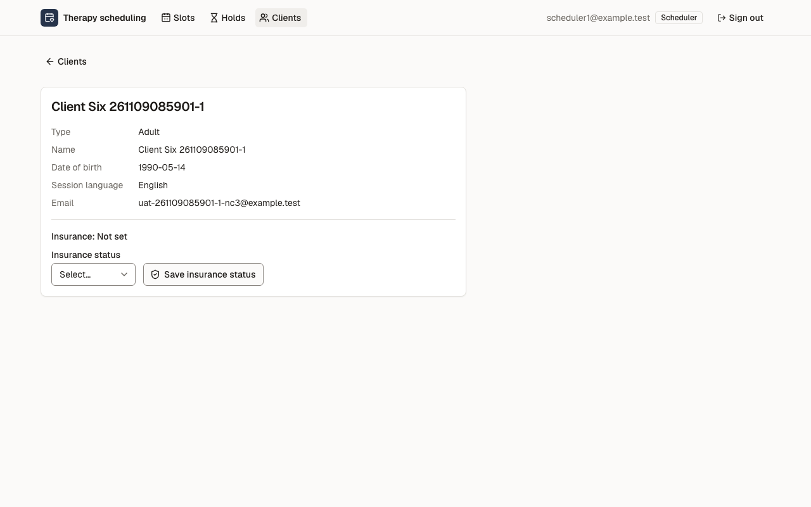

# Звіт UAT — 09.11.2026

- **Застосунок:** https://therapy-scheduling-sigma.vercel.app (/api/health: коміт `60b0bc0`)
- **Код тестів:** `task/uat-slice-3` @ `ab51d0c` + незакомічені зміни
- **Прогін:** 09.11.2026, 10:59 (Київ), Playwright 36.0 с; AC: 0 — PASS 0, FAIL 0, NEEDS-HUMAN 0; негативних контролів: 3
- **Рецензент:** `claude-haiku-5-5`; суперечки → `claude-sonnet-5-5`. Разом за розбір: $0.0377 (ціни API; за підпискою — у межах ліміту плану)
- **Прибирання:** не запускалось (прогін без SUPABASE_SECRET_KEY — лише AC, що нічого не пишуть)
- **Відео й траси:** відео негативних контролів перезаписав наступний прогін UAT (09.11 11:17), траси не збережено; кадри «Тоді» — `frames/NC-*.png`

| AC | Перевірки | Агент | Підсумок | Чому | Playwright | Розбір |
|---|---|---|---|---|---|---|
| NC-1 (AC-CARD-05) | впали | Haiku: PASS | **FAIL** | R1: перевірка впала — FAIL завжди, агент не перекриває | 6.9 с | $0.0018, 7.5 с |
| NC-2 (AC-CARD-05) | пройшли | Haiku: NEEDS-HUMAN, Sonnet: FAIL | **NEEDS-HUMAN** | R3: перевірки пройшли, агент не погоджується — вирішує людина | 2.2 с | $0.0342, 23.3 с |
| NC-3 (AC-INS-01) | впали | Haiku: PASS | **FAIL** | R1: перевірка впала — FAIL завжди, агент не перекриває | 13.2 с | $0.0017, 6.6 с |

## NC-1 — негативний контроль для AC-CARD-05 — FAIL

**Тест:** NC-1 (AC-CARD-05, навмисно хибне очікування в тесті: інший текст повідомлення)

**Критерій** (requirements/19-planuvalnyk-zapovniuie-kartku-klienta.md):

> AC-CARD-05: Дано client9 — свій клієнт лише для therapist2. Коли therapist1 відкриває картку client9 за прямим посиланням. Тоді therapist1 бачить повідомлення «You don't have access to this client.», жодних даних client9 не показано, і картка client9 не змінилася.



**Кроки:** ✔ Дано: client9 — свій клієнт лише для therapist2 → ✔ Коли: therapist1 відкриває картку client9 за прямим посиланням → ✘ Тоді: therapist1 бачить повідомлення «You don't have access to this client.», жодних даних client9 не показано, і картка client9 не змінилася.

**Перевірка впала:**

```
Error: expect(locator).toHaveText(expected) failed

Locator:  getByRole('main').getByRole('alert')
Expected: "You do not have access to this client."
Received: "You don't have access to this client."
Timeout:  5000ms

Call log:
```

**Агент (claude-haiku-5-5, PASS):** На кадрі frame-then-1.png у червоній рамці видно текст «You don't have access to this client.», дослівно збігається з критерієм. Під повідомленням немає жодних даних клієнта, видно лише навігацію (My clients) і шапку therapist1@example.test. Те, що картка client9 не змінилася, одним кадром не перевірити; це не входить до переліку видимих частин, тож не оцінювалося.

**Цитати агента, звірені зі сторінкою (aria):**
- «You don't have access to this client.» — є на сторінці

**Правило:** R1: перевірка впала — FAIL завжди, агент не перекриває

**Відео:** `test-results/artifacts/negative-controls-NC-1-AC--ef1a0-і-інший-текст-повідомлення--negative-controls/video.webm` · **траса:** `test-results/artifacts/negative-controls-NC-1-AC--ef1a0-і-інший-текст-повідомлення--negative-controls/trace.zip` (не в git)

_Негативний контроль: навмисно хибне очікування. Очікуваний підсумок — FAIL або NEEDS-HUMAN, не PASS._

## NC-2 — негативний контроль для AC-CARD-05 — NEEDS-HUMAN

**Тест:** NC-2 (AC-CARD-05, текст «Тоді» у вимозі уточнено, тест і застосунок — ні)

**Критерій** (анотація ac-text у тесті (негативний контроль)):

> AC-CARD-05: Дано client9 — свій клієнт лише для therapist2. Коли therapist1 відкриває картку client9 за прямим посиланням. Тоді therapist1 бачить повідомлення «This client card is private.», жодних даних client9 не показано, і картка client9 не змінилася.


**Кроки:** ✔ Дано: client9 — свій клієнт лише для therapist2 → ✔ Коли: therapist1 відкриває картку client9 за прямим посиланням → ✔ Тоді: therapist1 бачить повідомлення «You don't have access to this client.», жодних даних client9 не показано, і картка client9 не змінилася.

**Агент (claude-sonnet-5-5, FAIL):** На кадрі сторінка therapist1 з червоним банером «You don't have access to this client.», даних client9 не видно. Очікуваного за критерієм тексту «This client card is private.» на кадрі немає, тому посимвольне порівняння не проходить.

Haiku сказав NEEDS-HUMAN, тож розбір повторив Sonnet; рішення агента — за Sonnet.

**Агент бачить вади:**
- На кадрі показано «You don't have access to this client.», а критерій PM вимагає дослівно «This client card is private.» — тексти не збігаються.
- Перелік видимих частин у ac.md містить інший текст повідомлення, ніж дослівний критерій PM; розбіжність між критерієм і переліком потрібно уточнити.

**Правило:** R3: перевірки пройшли, агент не погоджується — вирішує людина

**Відео:** `test-results/artifacts/negative-controls-NC-2-AC--a0bf1-ено-тест-і-застосунок-—-ні--negative-controls/video.webm` · **траса:** `test-results/artifacts/negative-controls-NC-2-AC--a0bf1-ено-тест-і-застосунок-—-ні--negative-controls/trace.zip` (не в git)

_Негативний контроль: навмисно хибне очікування. Очікуваний підсумок — FAIL або NEEDS-HUMAN, не PASS._

## NC-3 — негативний контроль для AC-INS-01 — FAIL

**Тест:** NC-3 (AC-INS-01, навмисно хибне очікування в тесті: «Verified» замість «Not set»)

**Критерій** (requirements/33-planuvalnyk-poznachaie-status-strakhuvannia.md):

> AC-INS-01: Дано картку client6 створено, і статус перевірки страхування ще ніхто не позначав. Коли scheduler1 відкриває картку client6. Тоді в картці показано «Insurance: Not set».



**Кроки:** ✔ Дано: картку client6 створено, і статус перевірки страхування ще ніхто не позначав → ✔ Коли: scheduler1 відкриває картку client6 → ✘ Тоді: в картці показано «Insurance: Not set».

**Перевірка впала:**

```
Error: expect(locator).toHaveText(expected) failed

Locator:  getByTestId('insurance')
Expected: "Insurance: Verified"
Received: "Insurance: Not set"
Timeout:  5000ms

Call log:
```

**Агент (claude-haiku-5-5, PASS):** На кадрі видно картку «Client Six 261109085901-1» з рядком «Insurance: Not set» над полем «Insurance status» і кнопкою «Save insurance status». Текст збігається з критерієм посимвольно. Стан «Дано» я не оцінював, бо він не є видимою частиною «Тоді».

**Цитати агента, звірені зі сторінкою (aria):**
- «Insurance: Not set» — є на сторінці

**Правило:** R1: перевірка впала — FAIL завжди, агент не перекриває

**Відео:** `test-results/artifacts/negative-controls-зріз-3-N-92a2e-erified»-замість-«Not-set»--negative-controls/video.webm` · **траса:** `test-results/artifacts/negative-controls-зріз-3-N-92a2e-erified»-замість-«Not-set»--negative-controls/trace.zip` (не в git)

_Негативний контроль: навмисно хибне очікування. Очікуваний підсумок — FAIL або NEEDS-HUMAN, не PASS._

## Як читати підсумок

- **PASS** — автоматичні перевірки пройшли, агент-рецензент погодився з кадром, а кожну його цитату знайдено на сторінці.
- **FAIL** — впала автоматична перевірка. Агент цього не перекриває: невидимі вади (буфер обміну, база) він на кадрі не побачить.
- **NEEDS-HUMAN** — перевірки зелені, але агент не погодився або його цитати немає на сторінці. Часто це слабкий тест або розбіжність між текстом AC і тестом — питання до PM, а не обов'язково вада продукту.

Правила: R1: перевірка впала — FAIL завжди, агент не перекриває; R2: немає вердикту агента або кадру; R3: перевірки пройшли, агент не погоджується — вирішує людина; R4: цитати агента немає на сторінці (aria) — не підтверджено; R5: помилка сторінки або 5xx під час сценарію; R6: перевірки, агент і цитати збігаються.
