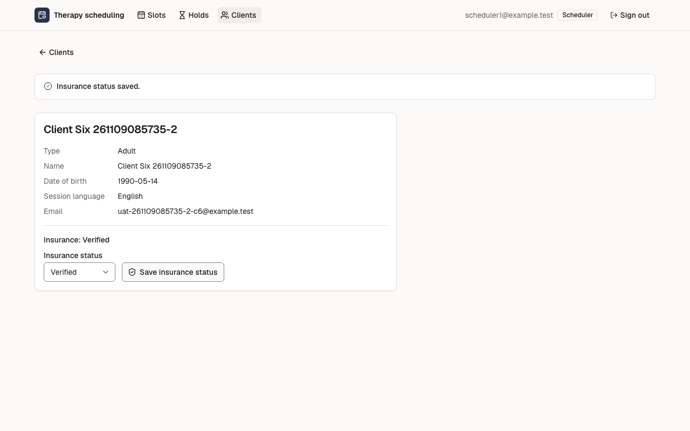
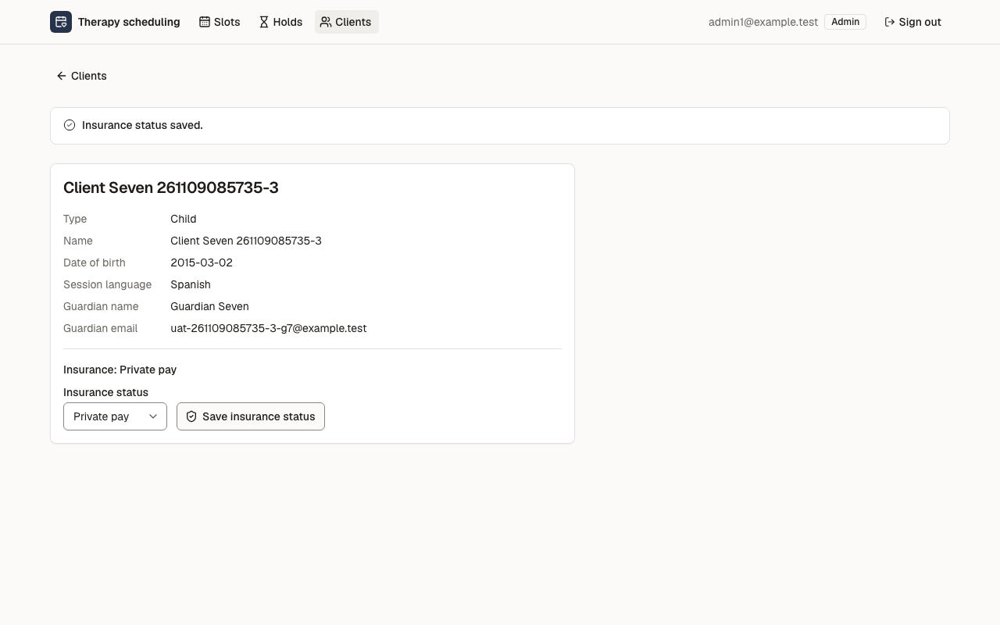
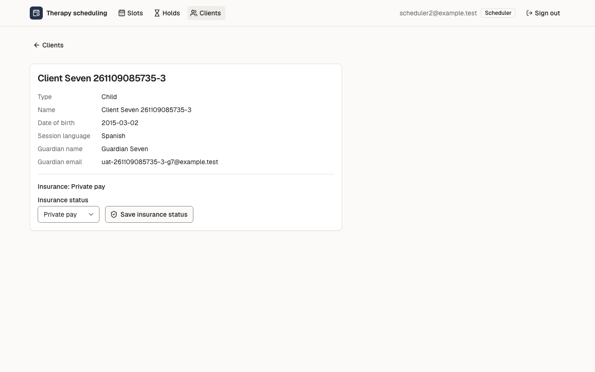
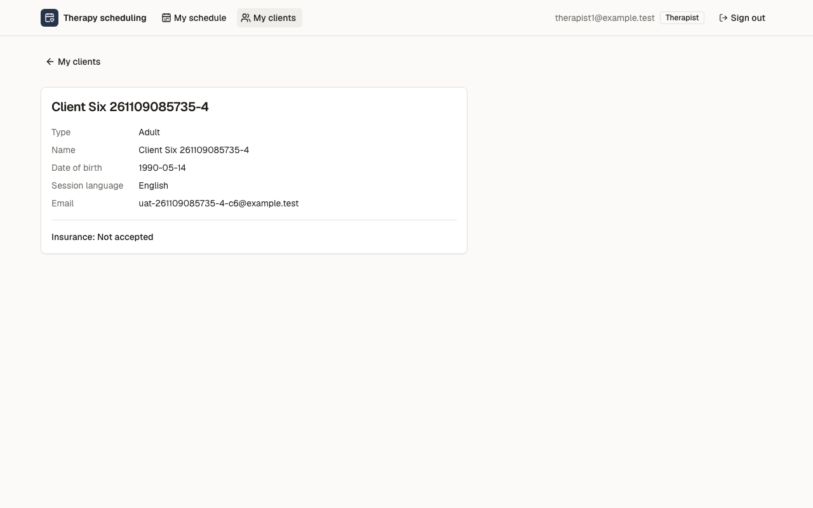
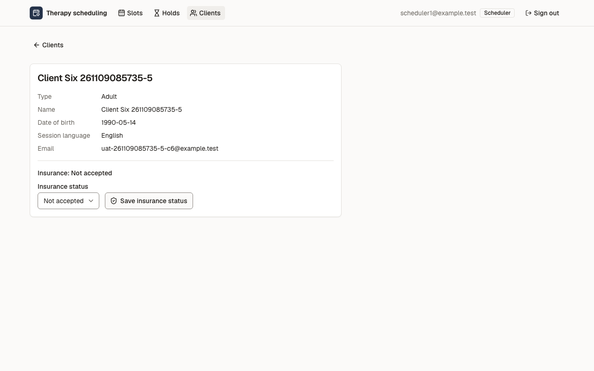
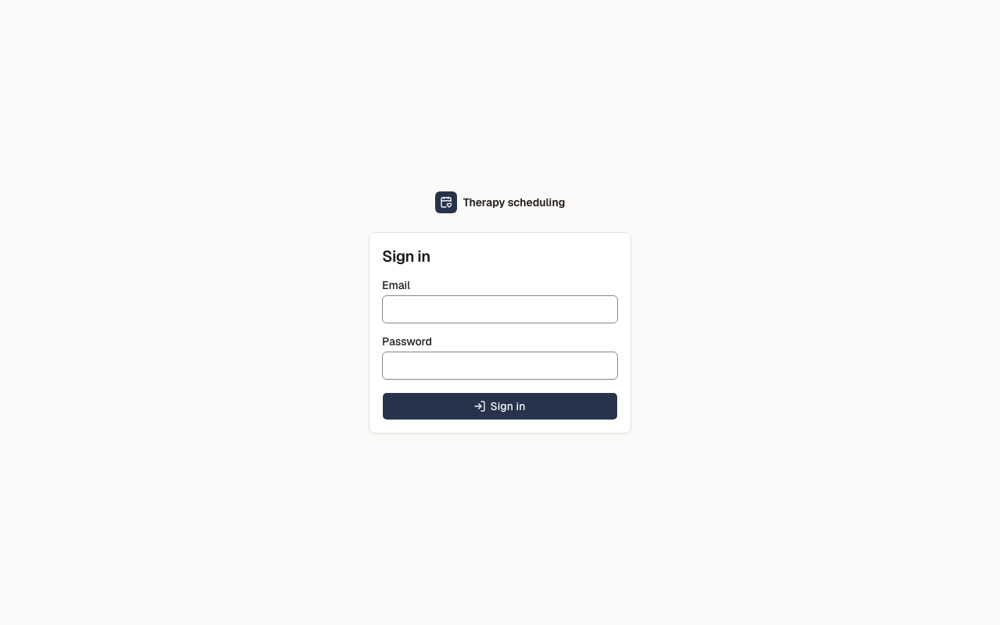
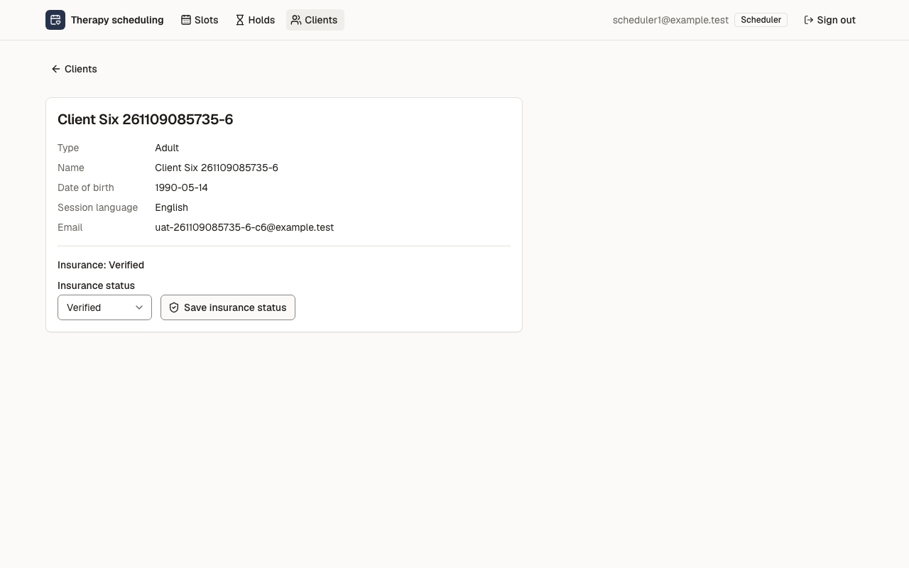

# Звіт UAT — 09.11.2026

- **Застосунок:** https://therapy-scheduling-sigma.vercel.app (/api/health: коміт `60b0bc0`)
- **Код тестів:** `task/uat-slice-3` @ `ab51d0c`
- **Прогін:** 09.11.2026, 10:57 (Київ), Playwright 58.6 с; AC: 6 — PASS 6, FAIL 0, NEEDS-HUMAN 0
- **Рецензент:** `claude-haiku-5-5`; суперечки → `claude-sonnet-5-5`. Разом за розбір: $0.0444 (ціни API; за підпискою — у межах ліміту плану)
- **Прибирання:** не запускалось (прогін без SUPABASE_SECRET_KEY — лише AC, що нічого не пишуть)
- **Відео й траси:** не в git — `test-results/` локально або артефакт CI; трасу відкриває `npx playwright show-trace <trace.zip>`

| AC | Перевірки | Агент | Підсумок | Чому | Playwright | Розбір |
|---|---|---|---|---|---|---|
| AC-INS-01 | пройшли | Haiku: PASS | **PASS** | R6: перевірки, агент і цитати збігаються | 7.4 с | $0.0018, 6.7 с |
| AC-INS-02 | пройшли | Haiku: PASS | **PASS** | R6: перевірки, агент і цитати збігаються | 9.6 с | $0.0022, 7.1 с |
| AC-INS-03 | пройшли | Haiku: PASS | **PASS** | R6: перевірки, агент і цитати збігаються | 11.8 с | $0.0022, 7.1 с |
| AC-INS-04 | пройшли | Haiku: NEEDS-HUMAN, Sonnet: PASS | **PASS** | R6: перевірки, агент і цитати збігаються | 5.4 с | $0.0338, 19.8 с |
| AC-INS-05 | пройшли | Haiku: PASS | **PASS** | R6: перевірки, агент і цитати збігаються | 6.9 с | $0.0020, 7.2 с |
| AC-INS-06 | пройшли | Haiku: PASS | **PASS** | R6: перевірки, агент і цитати збігаються | 4.2 с | $0.0024, 9.8 с |

## AC-INS-01 — PASS

**Тест:** AC-INS-01: scheduler1 відкриває щойно створену картку client6 — «Insurance: Not set»

**Критерій** (requirements/33-planuvalnyk-poznachaie-status-strakhuvannia.md):

> AC-INS-01: Дано картку client6 створено, і статус перевірки страхування ще ніхто не позначав. Коли scheduler1 відкриває картку client6. Тоді в картці показано «Insurance: Not set».

**Кроки:** ✔ Дано: картку client6 створено, і статус перевірки страхування ще ніхто не позначав → ✔ Коли: scheduler1 відкриває картку client6 → ✔ Тоді: в картці показано «Insurance: Not set».

**Агент (claude-haiku-5-5, PASS):** На кадрі видно картку клієнта «Client Six 261109085735-1» зі стрічкою «Insurance: Not set» над полем «Insurance status» і кнопкою «Save insurance status». Текст збігається з критерієм посимвольно, кадр читабельний і повний.

**Цитати агента, звірені зі сторінкою (aria):**
- «Insurance: Not set» — є на сторінці

**Правило:** R6: перевірки, агент і цитати збігаються

**Відео:** `test-results/artifacts/insurance-статус-перевірки-81e1e-ient6-—-«Insurance-Not-set»-chromium/video.webm` · **траса:** `test-results/artifacts/insurance-статус-перевірки-81e1e-ient6-—-«Insurance-Not-set»-chromium/trace.zip` (не в git)

**Рішення PM:** ☐ приймаю · ☐ відхилення від вимог (issue «Відхилення від вимог: AC-INS-01 — …») · @login: ____

## AC-INS-02 — PASS

**Тест:** AC-INS-02: scheduler1 позначає «Verified» — «Insurance status saved.» і «Insurance: Verified» після повторного відкриття

**Критерій** (requirements/33-planuvalnyk-poznachaie-status-strakhuvannia.md):

> AC-INS-02: Дано картка client6 показує «Insurance: Not set». Коли scheduler1 позначає статус перевірки страхування «Verified». Тоді scheduler1 бачить повідомлення «Insurance status saved.», а картка client6 показує «Insurance: Verified» і після того, як scheduler1 відкриє її знову.

**Кроки:** ✔ Дано: картка client6 показує «Insurance: Not set» → ✔ Коли: scheduler1 позначає статус перевірки страхування «Verified» → ✔ Тоді: scheduler1 бачить повідомлення «Insurance status saved.», а картка client6 показує «Insurance: Verified» → ✔ Коли: scheduler1 відкриває картку client6 знову → ✔ Тоді: картка client6 показує «Insurance: Verified» і після того, як scheduler1 відкриє її знову.

**Агент (claude-haiku-5-5, PASS):** На кадрі 1 видно зелене підтвердження «Insurance status saved.» над карткою «Client Six 261109085735-2», а в картці — «Insurance: Verified». На кадрі 2 (картка відкрита знову, сторінка та URL ті самі) рядок «Insurance: Verified» збережений. Усі видимі частини «Тоді» підтверджено дослівно.

**Цитати агента, звірені зі сторінкою (aria):**
- «Insurance status saved.» — є на сторінці
- «Insurance: Verified» — є на сторінці
- «Insurance: Verified» — є на сторінці

**Правило:** R6: перевірки, агент і цитати збігаються

**Відео:** `test-results/artifacts/insurance-статус-перевірки-c3fbf--після-повторного-відкриття-chromium/video.webm` · **траса:** `test-results/artifacts/insurance-статус-перевірки-c3fbf--після-повторного-відкриття-chromium/trace.zip` (не в git)

**Рішення PM:** ☐ приймаю · ☐ відхилення від вимог (issue «Відхилення від вимог: AC-INS-02 — …») · @login: ____

## AC-INS-03 — PASS

**Тест:** AC-INS-03: admin1 змінює «Verified» на «Private pay» — admin1 і scheduler2 бачать «Insurance: Private pay»

**Критерій** (requirements/33-planuvalnyk-poznachaie-status-strakhuvannia.md):

> AC-INS-03: Дано картка client7 показує «Insurance: Verified». Коли admin1 змінює статус перевірки страхування на «Private pay», а потім scheduler2 відкриває картку client7. Тоді і admin1, і scheduler2 бачать у картці «Insurance: Private pay».

**Кроки:** ✔ Дано: картка client7 показує «Insurance: Verified» → ✔ Коли: admin1 змінює статус перевірки страхування на «Private pay» → ✔ Тоді: admin1 бачить у картці «Insurance: Private pay» → ✔ Коли: scheduler2 відкриває картку client7 → ✔ Тоді: і admin1, і scheduler2 бачать у картці «Insurance: Private pay».

**Агент (claude-haiku-5-5, PASS):** На frame-then-1 у шапці видно admin1@example.test, а в картці Client Seven 261109085735-3 — рядок «Insurance: Private pay» (з повідомленням «Insurance status saved.»). На frame-then-2 у шапці видно scheduler2@example.test, а в тій самій картці знову «Insurance: Private pay». Усі видимі частини «Тоді» підтверджено дослівно.

**Цитати агента, звірені зі сторінкою (aria):**
- «Insurance: Private pay» — є на сторінці
- «scheduler2@example.test» — є на сторінці
- «Insurance: Private pay» — є на сторінці

**Правило:** R6: перевірки, агент і цитати збігаються

**Відео:** `test-results/artifacts/insurance-статус-перевірки-75f58-ать-«Insurance-Private-pay»-chromium/video.webm` · **траса:** `test-results/artifacts/insurance-статус-перевірки-75f58-ать-«Insurance-Private-pay»-chromium/trace.zip` (не в git)

**Рішення PM:** ☐ приймаю · ☐ відхилення від вимог (issue «Відхилення від вимог: AC-INS-03 — …») · @login: ____

## AC-INS-04 — PASS

**Тест:** AC-INS-04: therapist1 відкриває картку свого client6 — «Insurance: Not accepted» без можливості змінити

**Критерій** (requirements/33-planuvalnyk-poznachaie-status-strakhuvannia.md):

> AC-INS-04: Дано client6 — свій клієнт therapist1, і картка client6 показує «Insurance: Not accepted». Коли therapist1 відкриває картку client6. Тоді він бачить «Insurance: Not accepted», а змінити статус перевірки страхування в картці йому не запропоновано.

**Кроки:** ✔ Дано: client6 — свій клієнт therapist1, і картка client6 показує «Insurance: Not accepted» → ✔ Коли: therapist1 відкриває картку client6 → ✔ Тоді: він бачить «Insurance: Not accepted», а змінити статус перевірки страхування в картці йому не запропоновано.

**Агент (claude-sonnet-5-5, PASS):** На кадрі картка «Client Six 261109085735-4» під therapist1@example.test з рядками Type, Name, Date of birth, Session language, Email та підсумком «Insurance: Not accepted». Поля «Insurance status» і кнопки «Save insurance status» у картці немає, є лише цей текстовий рядок. Цитата для другої частини — єдиний рядок про страхування, бо відсутність елементів не можна процитувати.

Haiku сказав NEEDS-HUMAN, тож розбір повторив Sonnet; рішення агента — за Sonnet.

**Цитати агента, звірені зі сторінкою (aria):**
- «Insurance: Not accepted» — є на сторінці
- «Insurance: Not accepted» — є на сторінці

**Правило:** R6: перевірки, агент і цитати збігаються

**Відео:** `test-results/artifacts/insurance-статус-перевірки-09367-ted»-без-можливості-змінити-chromium/video.webm` · **траса:** `test-results/artifacts/insurance-статус-перевірки-09367-ted»-без-можливості-змінити-chromium/trace.zip` (не в git)

**Рішення PM:** ☐ приймаю · ☐ відхилення від вимог (issue «Відхилення від вимог: AC-INS-04 — …») · @login: ____

## AC-INS-05 — PASS

**Тест:** AC-INS-05: therapist1 напряму, оминаючи сторінки, пробує змінити статус client6 на «Verified» — scheduler1 бачить «Insurance: Not accepted»

**Критерій** (requirements/33-planuvalnyk-poznachaie-status-strakhuvannia.md):

> AC-INS-05: Дано client6 — свій клієнт therapist1, і картка client6 показує «Insurance: Not accepted». Коли therapist1 напряму, оминаючи сторінки застосунку, пробує змінити статус перевірки страхування client6 на «Verified». Тоді статус не змінився: scheduler1 у картці client6 бачить «Insurance: Not accepted».

**Кроки:** ✔ Дано: client6 — свій клієнт therapist1, і картка client6 показує «Insurance: Not accepted» → ✔ Коли: therapist1 напряму, оминаючи сторінки застосунку, пробує змінити статус на «Verified» → ✔ Тоді: статус не змінився: scheduler1 у картці client6 бачить «Insurance: Not accepted».

**Агент (claude-haiku-5-5, PASS):** На кадрі frame-then-1.png у шапці видно «scheduler1@example.test» (сесія scheduler1 з роллю Scheduler), а в картці клієнта «Client Six 261109085735-5» — рядок «Insurance: Not accepted» без змін. Кадр чіткий, обрізання немає. Частини з розділу «Не з кадрів» не оцінювались.

**Цитати агента, звірені зі сторінкою (aria):**
- «scheduler1@example.test» — є на сторінці
- «Insurance: Not accepted» — є на сторінці

**Правило:** R6: перевірки, агент і цитати збігаються

**Відео:** `test-results/artifacts/insurance-статус-перевірки-de2c9-ть-«Insurance-Not-accepted»-chromium/video.webm` · **траса:** `test-results/artifacts/insurance-статус-перевірки-de2c9-ть-«Insurance-Not-accepted»-chromium/trace.zip` (не в git)

**Рішення PM:** ☐ приймаю · ☐ відхилення від вимог (issue «Відхилення від вимог: AC-INS-05 — …») · @login: ____

## AC-INS-06 — PASS

**Тест:** AC-INS-06: користувач без входу відкриває картку client6 — лише сторінка входу, scheduler1 бачить «Insurance: Verified»

**Критерій** (requirements/33-planuvalnyk-poznachaie-status-strakhuvannia.md):

> AC-INS-06: Дано користувач не увійшов у застосунок, а картка client6 показує «Insurance: Verified». Коли він відкриває картку client6 за прямим посиланням. Тоді він бачить лише сторінку входу, статусу страхування й інших даних client6 не показано, а scheduler1 після цього бачить у картці client6 «Insurance: Verified».

**Кроки:** ✔ Дано: користувач не увійшов у застосунок, а картка client6 показує «Insurance: Verified» → ✔ Коли: він відкриває картку client6 за прямим посиланням → ✔ Тоді: він бачить лише сторінку входу, статусу страхування й інших даних client6 не показано → ✔ Тоді: а scheduler1 після цього бачить у картці client6 «Insurance: Verified».

**Агент (claude-haiku-5-5, PASS):** На frame-then-1 видно сторінку входу «Sign in» з полями «Email» і «Password», без даних картки client6. На frame-then-2 у шапці показано scheduler1@example.test, а в картці клієнта є рядок «Insurance: Verified». Частина «scheduler1 у шапці» зіставлена за логіном у шапці; якщо PM вимагає саме слово без домену, це варто підтвердити.

**Цитати агента, звірені зі сторінкою (aria):**
- «Sign in» — є на сторінці
- «Email» — є на сторінці
- «Password» — є на сторінці
- «scheduler1@example.test» — є на сторінці
- «Insurance: Verified» — є на сторінці

**Правило:** R6: перевірки, агент і цитати збігаються

**Відео:** `test-results/artifacts/insurance-без-входу-AC-INS-f39eb-бачить-«Insurance-Verified»-chromium/video.webm` · **траса:** `test-results/artifacts/insurance-без-входу-AC-INS-f39eb-бачить-«Insurance-Verified»-chromium/trace.zip` (не в git)

**Рішення PM:** ☐ приймаю · ☐ відхилення від вимог (issue «Відхилення від вимог: AC-INS-06 — …») · @login: ____

## Як читати підсумок

- **PASS** — автоматичні перевірки пройшли, агент-рецензент погодився з кадром, а кожну його цитату знайдено на сторінці.
- **FAIL** — впала автоматична перевірка. Агент цього не перекриває: невидимі вади (буфер обміну, база) він на кадрі не побачить.
- **NEEDS-HUMAN** — перевірки зелені, але агент не погодився або його цитати немає на сторінці. Часто це слабкий тест або розбіжність між текстом AC і тестом — питання до PM, а не обов'язково вада продукту.

Правила: R1: перевірка впала — FAIL завжди, агент не перекриває; R2: немає вердикту агента або кадру; R3: перевірки пройшли, агент не погоджується — вирішує людина; R4: цитати агента немає на сторінці (aria) — не підтверджено; R5: помилка сторінки або 5xx під час сценарію; R6: перевірки, агент і цитати збігаються.
