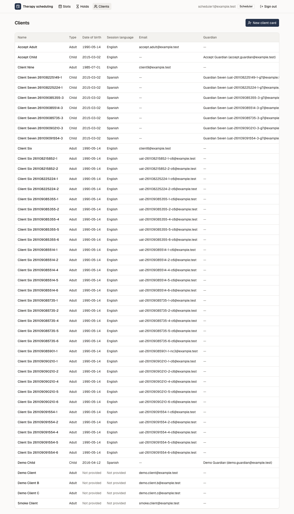
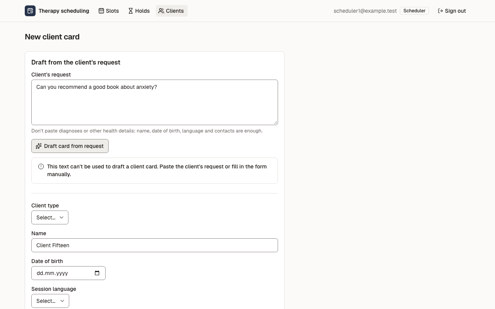

# Звіт UAT — 15.11.2026

- **Застосунок:** https://therapy-scheduling-sigma.vercel.app (/api/health: коміт `c7b9888`)
- **Код тестів:** `uat/intake-draft` @ `b7432fc`
- **Прогін:** 15.11.2026, 17:07 (Київ), Playwright 30.1 с; AC: 2 — PASS 2, FAIL 0, NEEDS-HUMAN 0
- **Рецензент:** `claude-haiku-5-5`; суперечки → `claude-sonnet-5-5`. Разом за розбір: $0.0049 (ціни API; за підпискою — у межах ліміту плану)
- **Прибирання:** не запускалось (прогін без SUPABASE_SECRET_KEY): користувачів Auth `uat-*` не видалено; дані тестів з `@writes` — синтетичні `*@example.test` — лишились на проді
- **Відео:** assets pre-release [uat-2026-11-15](https://github.com/maryan-qc/therapy-scheduling/releases/tag/uat-2026-11-15) (у git відео не кладемо); траси не збережено

| AC | Перевірки | Агент | Підсумок | Чому | Playwright | Розбір |
|---|---|---|---|---|---|---|
| AC-INTAKE-03 | пройшли | Haiku: PASS | **PASS** | R6: перевірки, агент і цитати збігаються | 10.3 с | $0.0028, 11.6 с |
| AC-INTAKE-06 | пройшли | Haiku: PASS | **PASS** | R6: перевірки, агент і цитати збігаються | 7.6 с | $0.0021, 9.5 с |

## AC-INTAKE-03 — PASS

**Тест:** AC-INTAKE-03: scheduler1 не створює картку з чернетки за текстом AC-INTAKE-01 — у списку клієнтів картки «Client Ten» немає

**Критерій** (requirements/36-chernetka-kartky-z-tekstu-zvernennia.md):

> AC-INTAKE-03: Дано чернетку за текстом з AC-INTAKE-01 заповнено у формі нової картки. Коли scheduler1 не створює картку й відкриває список клієнтів. Тоді картки «Client Ten» у списку немає: картку створює лише сам планувальник, коли зберігає форму.

**Кроки:** ✔ Дано: чернетку за текстом з AC-INTAKE-01 заповнено у формі нової картки → ✔ Коли: scheduler1 не створює картку й відкриває список клієнтів → ✔ Тоді: картки «Client Ten» у списку немає: картку створює лише сам планувальник, коли зберігає форму.

**Агент (claude-haiku-5-5, PASS):** На кадрі видно сторінку «Clients» з обліковим записом scheduler1@example.test, а список таблиці повний і відсортований за іменем: після «Client Six 261109091554-6» одразу йде «Demo Child», тож картки «Client Ten» немає. Частина про те, що картку створює лише планувальник при збереженні, на кадрі не видна, тому не оцінювалась.

**Цитати агента, звірені зі сторінкою (aria):**
- «Clients» — є на сторінці
- «scheduler1@example.test» — є на сторінці
- «Client Six 261109091554-6» — є на сторінці
- «Demo Child» — є на сторінці

**Правило:** R6: перевірки, агент і цитати збігаються

**Відео:** [AC-INTAKE-03.webm](https://github.com/maryan-qc/therapy-scheduling/releases/download/uat-2026-11-15/AC-INTAKE-03.webm) (assets pre-release) · траса не збережена

**Рішення PM:** ☐ приймаю · ☐ відхилення від вимог (issue «Відхилення від вимог: AC-INTAKE-03 — …») · @login: ____

## AC-INTAKE-06 — PASS

**Тест:** AC-INTAKE-06: scheduler1 з Name «Client Fifteen» у формі просить чернетку з тексту не про нового клієнта — форма без змін і «This text can't be used to draft a client card. …»

**Критерій** (requirements/36-chernetka-kartky-z-tekstu-zvernennia.md):

> AC-INTAKE-06: Дано у формі нової картки вже введено Name «Client Fifteen». Коли scheduler1 просить скласти чернетку з тексту звернення «Can you recommend a good book about anxiety?». Тоді поля форми не змінено (Name лишається «Client Fifteen»), і scheduler1 бачить повідомлення «This text can't be used to draft a client card. Paste the client's request or fill in the form manually.»

**Кроки:** ✔ Дано: у формі нової картки вже введено Name «Client Fifteen» → ✔ Коли: scheduler1 просить скласти чернетку з тексту звернення «Can you recommend a good book about anxiety?» → ✔ Тоді: поля форми не змінено (Name лишається «Client Fifteen»), і scheduler1 бачить повідомлення «This text can't be used to draft a client card. Paste the client's request or fill in the form manually.»

**Агент (claude-haiku-5-5, PASS):** На кадрі frame-then-1.png (сторінка New client card) під кнопкою «Draft card from request» видно повідомлення, яке дослівно збігається з критерієм. Поле Name містить «Client Fifteen», тобто його значення не змінилося. Апостроф у «can't» і «client's» на скріншоті виглядає як прямий, але при цій роздільності відрізнити прямий від типографського апострофа важко; я його не ставлю як дефект.

**Цитати агента, звірені зі сторінкою (aria):**
- «This text can't be used to draft a client card. Paste the client's request or fill in the form manually.» — є на сторінці
- «Client Fifteen» — є на сторінці

**Правило:** R6: перевірки, агент і цитати збігаються

**Відео:** [AC-INTAKE-06.webm](https://github.com/maryan-qc/therapy-scheduling/releases/download/uat-2026-11-15/AC-INTAKE-06.webm) (assets pre-release) · траса не збережена

**Рішення PM:** ☐ приймаю · ☐ відхилення від вимог (issue «Відхилення від вимог: AC-INTAKE-06 — …») · @login: ____

## Як читати підсумок

- **PASS** — автоматичні перевірки пройшли, агент-рецензент погодився з кадром, а кожну його цитату знайдено на сторінці.
- **FAIL** — впала автоматична перевірка. Агент цього не перекриває: невидимі вади (буфер обміну, база) він на кадрі не побачить.
- **NEEDS-HUMAN** — перевірки зелені, але агент не погодився або його цитати немає на сторінці. Часто це слабкий тест або розбіжність між текстом AC і тестом — питання до PM, а не обов'язково вада продукту.

Правила: R1: перевірка впала — FAIL завжди, агент не перекриває; R2: немає вердикту агента або кадру; R3: перевірки пройшли, агент не погоджується — вирішує людина; R4: цитати агента немає на сторінці (aria) — не підтверджено; R5: помилка сторінки або 5xx під час сценарію; R6: перевірки, агент і цитати збігаються.
